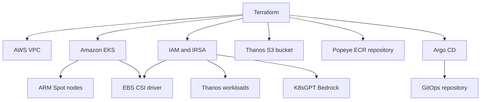

# Say When Infrastructure

Terraform infrastructure for my AWS EKS and GitOps DevSecOps home lab.

This repository provisions the AWS infrastructure, creates the EKS cluster, configures supporting IAM resources, installs Argo CD, and bootstraps the related GitOps repository.

For walkthroughs, screenshots, and explanations, visit:

[I'm Your Huckleberry](https://im-your-huckleberry.com/)

The related GitOps repository is:

[Say When GitOps](https://github.com/earpjennings37/say_when_git_ops)

In theory it sounded good, however every step along the way to see the downstream effect failed.. Soooo w/that said take a peak at stuff in here & see what you think as i mess w/following - or if you dont wanna do that, here are some more random quotes to read:
- "Iron" Mike Tyson - "everyone has a plan until they get punched in the face"
- Leslie Chow from The Hangover - "whatchu talkin bout Willis!? dah him!?"
- Penneywise - "here, take..it.."
- Doc Holliday - "say when, im your huckleberry.."

## Architecture



## Deployment flow

```text
Terraform
   |
   +-- VPC and networking
   +-- EKS control plane and managed node group
   +-- IAM and IRSA roles
   +-- EBS CSI add-on
   +-- S3 and ECR resources
   +-- Argo CD installation
          |
          +-- GitOps bootstrap
                 |
                 +-- Security tooling
                 +-- Monitoring stack
                 +-- Operational tooling
```

Terraform manages the AWS infrastructure and the initial Argo CD installation. Kubernetes applications are managed separately through GitOps.

## Repository structure

```text
.
├── argocd.tf              # Argo CD installation
├── bootstrap.tf           # GitOps bootstrap
├── data.tf                # Terraform data sources
├── ebs-csi.tf             # EBS CSI add-on and IRSA
├── ecr-popeye.tf          # ECR repository for Popeye
├── eks.tf                 # EKS cluster and node configuration
├── helm.tf                # Helm provider configuration
├── locals.tf              # Shared local values
├── outputs.tf             # Terraform outputs
├── policies.tf            # Supporting IAM policies
├── providers.tf           # AWS, Kubernetes and Helm providers
├── s3-endpoint.tf         # S3 VPC endpoint
├── s3.tf                  # Thanos object-storage bucket
├── thanos-iam.tf          # Thanos IRSA role and trust policy
├── thanos-policy.tf       # Thanos S3 permissions
├── variables.tf           # Input variables
├── vpc.tf                 # VPC configuration
└── README.md
```

## AWS services

| Service | Purpose |
|---|---|
| Amazon VPC | Provides networking for the EKS cluster |
| Amazon EKS | Runs the Kubernetes control plane |
| EC2 Spot | Provides lower-cost ARM worker nodes |
| IAM | Controls AWS access and workload identities |
| EBS CSI Driver | Provisions Kubernetes persistent volumes |
| Amazon S3 | Stores Thanos metrics objects |
| Amazon ECR | Stores the custom ARM64 Popeye image |
| Amazon Bedrock | Provides AI inference for K8sGPT |
| VPC Endpoints | Provides private access to selected AWS services |

## Design choices

The lab emphasizes low operating cost:

- ARM-based EC2 instances
- Spot capacity
- Small node groups
- Minimal monitoring replicas
- Small persistent volumes
- ClusterIP services
- Short Prometheus retention
- Optional infrastructure disabled when not required
- Complete cluster destruction between lab sessions

These decisions trade availability and durability for lower cost.

## Prerequisites

Install and configure:

- AWS CLI
- Terraform
- kubectl
- Helm
- Git

Confirm AWS authentication:

```bash
aws sts get-caller-identity
```

Review the configured AWS region:

```bash
aws configure get region
```

## Initialize Terraform

```bash
terraform init
terraform fmt -check
terraform validate
```

## Review the deployment

Create a saved plan:

```bash
terraform plan -out=tfplan
```

Review the plan carefully before applying it:

```bash
terraform show tfplan
```

## Create the infrastructure

```bash
terraform apply tfplan
```

Terraform creates billable AWS resources. Review the plan and AWS pricing before applying it.

## Configure kubectl

After Terraform completes:

```bash
aws eks update-kubeconfig \
  --region us-east-1 \
  --name say-when-east
```

Verify access:

```bash
kubectl get nodes
kubectl get pods -A
```

## Verify Argo CD

```bash
kubectl get applications -n argocd
```

The applications may initially display `Progressing` while Helm charts, persistent volumes, and workloads are created.

## Post-deployment Grafana Secret

The Grafana administrator password is not stored in Terraform or Git.

After the `monitoring` namespace exists:

```bash
kubectl wait \
  --for=jsonpath='{.status.phase}'=Active \
  namespace/monitoring \
  --timeout=300s

read -rsp 'Grafana admin password: ' GRAFANA_PASSWORD
echo

kubectl create secret generic grafana-admin-credentials \
  --namespace monitoring \
  --from-literal=admin-user=admin \
  --from-literal=admin-password="$GRAFANA_PASSWORD" \
  --dry-run=client \
  -o yaml |
kubectl apply -f -

unset GRAFANA_PASSWORD
```

This step is required after every complete cluster rebuild.

## Destroy the lab

Create and review a destruction plan:

```bash
terraform plan -destroy -out=destroy.tfplan
terraform show destroy.tfplan
```

Destroy the managed infrastructure:

```bash
terraform apply destroy.tfplan
```

Verify that expensive resources were removed:

```bash
aws eks list-clusters --region us-east-1
aws ec2 describe-nat-gateways \
  --region us-east-1 \
  --filter Name=state,Values=available,pending
```

Some resources may intentionally remain, such as state storage, retained S3 data, ECR images, or persistent volumes, depending on their lifecycle configuration.

## Terraform state

Terraform state can contain sensitive infrastructure information and must not be committed to Git.

The repository should ignore:

```gitignore
.terraform/
*.tfstate
*.tfstate.*
*.tfplan
terraform.tfvars
terraform.tfvars.json
*.auto.tfvars
*.auto.tfvars.json
crash.log
crash.*.log
```

For collaborative or long-term use, store state in a secured remote backend with encryption, state locking, access controls, and versioning.

## IAM and IRSA

Kubernetes workloads use IAM Roles for Service Accounts instead of static AWS credentials.

Examples include:

- EBS CSI controller access to Amazon EBS
- Prometheus and Thanos access to the Thanos S3 bucket
- K8sGPT access to Amazon Bedrock

IRSA trust policies restrict role assumption using the EKS OIDC provider and Kubernetes service-account identity.

No AWS access key should be stored in Terraform, Kubernetes manifests, Helm values, or GitHub.

## Security considerations

Before publishing or sharing the repository:

```bash
gitleaks git . --redact
```

Also verify that sensitive generated files are not tracked:

```bash
git ls-files |
grep -Ei \
'(\.tfstate|\.tfvars|\.tfplan|\.env|kubeconfig|\.pem$|\.key$|credentials)'
```

AWS account IDs, IAM role ARNs, regions, and resource names are identifiers rather than credentials. They may still be replaced with examples in a sanitized portfolio copy if desired.

## Cost considerations

Potential cost-generating resources include:

- EKS control plane
- EC2 worker nodes
- EBS volumes and snapshots
- NAT gateways, if configured
- S3 storage and requests
- ECR storage
- Bedrock model inference
- CloudWatch logs
- Data transfer

Destroy the cluster when it is not being used and review AWS Cost Explorer and AWS Budgets regularly.

## Local AI tooling

Kiro CLI and kubectl-ai run locally and are not installed into EKS by this Terraform repository.

K8sGPT is different: it runs as a Kubernetes workload and uses Amazon Bedrock through an IRSA role managed by this infrastructure.

## Disclaimer

This repository is an educational home lab and portfolio project. It is intentionally optimized for experimentation and reduced cost rather than production availability. Review security, networking, scaling, backup, secret-management, and disaster-recovery requirements before adapting the code for production.