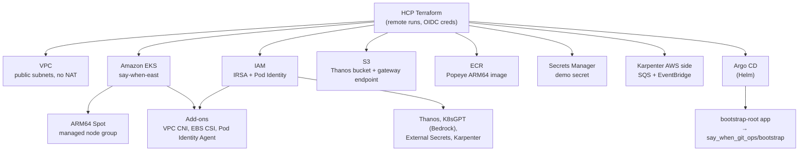

# Say When Infrastructure 🤠

Terraform for my AWS EKS + GitOps DevSecOps home lab.

This repo builds the AWS side of the lab: networking, the EKS cluster, IAM for the workloads, and Argo CD. Argo CD then points at [say_when_git_ops](https://github.com/earpjennings37/say_when_git_ops), which installs everything that runs *inside* the cluster.

| | |
| --- | --- |
| 📖 Blog walkthroughs and screenshots | [I'm Your Huckleberry](https://im-your-huckleberry.com/) |
| ☸️ What runs on the cluster | [say_when_git_ops](https://github.com/earpjennings37/say_when_git_ops) |
| 🧾 Commands from each blog post | [say_when_blog](https://github.com/earpjennings37/say_when_blog) |

> In theory it all sounded good. In practice, plenty of steps broke along the way before the downstream pieces worked. Poke around, steal what's useful, and read the blog for the war stories.

## Architecture



**Who owns what:** Terraform owns the AWS resources and the first Argo CD install. Everything else in the cluster (monitoring, security tools, Karpenter controller, External Secrets, Envoy Gateway, Rollouts) is owned by GitOps.

## What gets built

| Area | Details | File |
| --- | --- | --- |
| Networking | VPC in `us-east-1` across 2 AZs, public subnets only, internet gateway, **no NAT gateway** (saves money) | `vpc.tf` |
| EKS | `say-when-east`, public API endpoint, `API_AND_CONFIG_MAP` auth, admin access entry for your IAM Identity Center role | `eks.tf` |
| Nodes | Managed node group on **ARM64 Spot** (`t4g.medium`, `c6g.large`, `c7g.large`), 2–3 nodes | `eks.tf` |
| Networking add-on | VPC CNI with network policy enforcement and prefix delegation turned on | `eks.tf` |
| Storage | EBS CSI driver add-on with its own IRSA role | `ebs-csi.tf` |
| Autoscaling | Karpenter IAM (Pod Identity), Spot interruption queue, stable node instance profile. The controller itself comes from GitOps. | `karpenter.tf` |
| Secrets | Pod Identity Agent, a demo secret in Secrets Manager, and a read-only role for External Secrets Operator | `external-secrets.tf` |
| Metrics storage | S3 bucket for Thanos, blocked from public access, plus an S3 gateway endpoint | `s3.tf`, `s3-endpoint.tf` |
| Metrics IAM | IRSA role so Thanos can read and write that bucket | `thanos-iam.tf`, `thanos-policy.tf` |
| AI | IRSA role that lets K8sGPT call Amazon Bedrock (`amazon.nova-lite-v1:0`) | `k8sgpt-iam.tf` |
| Images | ECR repo for a custom ARM64 Popeye image | `ecr-popeye.tf` |
| GitOps | Argo CD Helm chart `7.1.0` plus the `bootstrap-root` Application | `argocd.tf`, `bootstrap.tf` |
| Optional west | A second VPC, cluster and Argo CD in another region, off by default (`enable_west = false`) | `vpc.tf`, `eks.tf`, `argocd.tf` |

## How workloads get AWS access

No static AWS keys anywhere. Pods get short-lived credentials one of two ways:

| Workload | Method | Can do |
| --- | --- | --- |
| EBS CSI controller | IRSA | Create and attach EBS volumes |
| Thanos / Prometheus sidecar | IRSA | Read/write the Thanos S3 bucket |
| K8sGPT | IRSA | Invoke one Bedrock model |
| External Secrets Operator | EKS Pod Identity | Read **only** the demo secret |
| Karpenter controller | EKS Pod Identity | Launch/terminate nodes, read the interruption queue |

## Repository structure

```text
.
├── bootstrap/hcp-terraform/   # One-time: OIDC provider + IAM role for HCP Terraform
├── helm-charts/argocd/        # Argo CD Helm values
├── images/popeye/             # Dockerfile for the ARM64 Popeye image
├── scripts/
│   ├── build-secure-popeye.sh # Build, push, SBOM and sign the Popeye image
│   └── verify-cluster.sh      # Quick health check after a deploy
├── .github/workflows/         # fmt, validate, TFLint and Trivy on every PR
├── providers.tf               # HCP Terraform backend + AWS/Helm/kubectl providers
├── variables.tf / locals.tf / data.tf / outputs.tf
├── vpc.tf  eks.tf  ebs-csi.tf  karpenter.tf
├── external-secrets.tf  k8sgpt-iam.tf
├── s3.tf  s3-endpoint.tf  thanos-iam.tf  thanos-policy.tf  policies.tf
├── ecr-popeye.tf
└── argocd.tf  helm.tf  bootstrap.tf
```

## Prerequisites

- An AWS account and an IAM Identity Center admin role (for `kubectl` access)
- An [HCP Terraform](https://app.terraform.io/) organization and workspace (this repo uses org `MyBlogJourney24`, workspace `say_when_infra`)
- Terraform `>= 1.11` (CI uses `1.14.5`), AWS CLI, `kubectl`, Helm, Git
- Docker (with buildx), Syft and Cosign, only if you build the Popeye image

```bash
aws sts get-caller-identity
```

## Deploy

### 1. One-time: let HCP Terraform into AWS

`bootstrap/hcp-terraform` creates an OIDC trust between HCP Terraform and AWS, so remote runs use short-lived credentials instead of access keys. Run it once with your own AWS credentials:

```bash
cd bootstrap/hcp-terraform
terraform init
terraform apply
terraform output hcp_terraform_role_arn
```

In the HCP workspace, set these **environment variables**:

| Variable | Value |
| --- | --- |
| `TFC_AWS_PROVIDER_AUTH` | `true` |
| `TFC_AWS_RUN_ROLE_ARN` | the `hcp_terraform_role_arn` output |

> ⚠️ The bootstrap role has `AdministratorAccess` to keep the lab simple. Narrow it before using this anywhere real.

### 2. Set the workspace variables

Set these as **Terraform variables** in the HCP workspace (or in a local `*.auto.tfvars` file, which git ignores):

| Variable | Required | Example |
| --- | --- | --- |
| `regions` | ✅ | `{ east = "us-east-1", west = "us-west-2" }` |
| `east_cidr` | ✅ | `"10.0.0.0/16"` (must contain the `10.0.1.0/24` and `10.0.2.0/24` subnets set in `vpc.tf`) |
| `west_cidr` | ✅ | `"10.1.0.0/16"` (must contain `10.1.1.0/24` and `10.1.2.0/24`) |
| `bucket_name` | ✅ | a globally unique name for the Thanos bucket |
| `eks_admin_principal_arn` | ✅ | `arn:aws:iam::<account>:role/aws-reserved/sso.amazonaws.com/AWSReservedSSO_AdministratorAccess_<id>` |
| `enable_west` | | `false` |
| `cluster_version` | | `"1.31"` (see the cost note below) |
| `node_instance_types` | | `["t4g.medium", "c6g.large", "c7g.large"]` |
| `node_min_size` / `node_desired_size` / `node_max_size` | | `2` / `3` / `3` |

### 3. Plan and apply

Runs happen in HCP Terraform. You can start them from the UI or from the CLI:

```bash
terraform login
terraform init
terraform fmt -check -recursive
terraform validate
terraform plan
terraform apply
```

> 💸 This creates billable AWS resources. Read the plan first.

### 4. Connect to the cluster

```bash
aws eks update-kubeconfig --region us-east-1 --name say-when-east
./scripts/verify-cluster.sh
```

### 5. Check Argo CD

```bash
kubectl get applications -n argocd
```

Apps show `Progressing` for a few minutes while charts, volumes and pods come up. The Argo CD UI is ClusterIP only, so port-forward to it:

```bash
kubectl -n argocd get secret argocd-initial-admin-secret \
  -o jsonpath='{.data.password}' | base64 -d; echo
kubectl -n argocd port-forward svc/argocd-server 8080:80
# open http://localhost:8080 and log in as admin
```

### 6. Create the Grafana admin secret

The Grafana password isn't stored in Terraform or Git. Do this **after every full rebuild**, once the `monitoring` namespace exists:

```bash
kubectl wait --for=jsonpath='{.status.phase}'=Active \
  namespace/monitoring --timeout=300s

read -rsp 'Grafana admin password: ' GRAFANA_PASSWORD; echo

kubectl create secret generic grafana-admin-credentials \
  --namespace monitoring \
  --from-literal=admin-user=admin \
  --from-literal=admin-password="$GRAFANA_PASSWORD" \
  --dry-run=client -o yaml | kubectl apply -f -

unset GRAFANA_PASSWORD
```

## Outputs

| Output | What it's for |
| --- | --- |
| `cluster_name`, `cluster_endpoint`, `cluster_oidc_provider_arn` | Connecting to the cluster and wiring up IRSA |
| `k8sgpt_bedrock_role_arn` | Service account annotation for K8sGPT |
| `external_secrets_role_arn`, `demo_secrets_manager_secret_name` | External Secrets setup |
| `karpenter_*` | Values for the Karpenter Helm chart and `EC2NodeClass` |
| `popeye_ecr_repository_url` | Where `build-secure-popeye.sh` pushes |
| `argocd_server_service`, `grafana_service` | In-cluster DNS names |

## Popeye image (optional)

The Popeye CronJob in GitOps runs a custom ARM64 image. `scripts/build-secure-popeye.sh` builds it from `images/popeye/Dockerfile` (Alpine, non-root user), pushes it to ECR, generates CycloneDX and SPDX SBOMs with Syft, and signs it with Cosign. ECR scans it on push.

```bash
export COSIGN_IDENTITY="<your signing identity>"   # optional; turns on strict signature verification
./scripts/build-secure-popeye.sh
```

SBOMs go to `artifacts/sbom/`, which git ignores.

## CI

`.github/workflows/terraform-validate.yaml` runs on every PR and every push to `main` that touches Terraform:

- `terraform fmt` and `terraform validate`
- **TFLint** with the AWS ruleset
- **Trivy** IaC scan for HIGH/CRITICAL issues. This one only reports; it doesn't fail the build.

## Cost

The lab is built to be cheap and disposable:

- ARM64 Spot nodes, small node group, small volumes
- No NAT gateway (nodes sit in public subnets instead)
- S3 gateway endpoint (free) for Thanos traffic
- ClusterIP services only, no load balancers
- Short Prometheus retention, minimal replicas
- The demo secret is deleted right away on destroy (`recovery_window_in_days = 0`)
- **Tear it all down between sessions**

What still costs money while it's up: the EKS control plane, EC2 Spot nodes, EBS volumes, S3, ECR, Secrets Manager, Bedrock calls and data transfer.

> ⚠️ **Kubernetes version:** EKS charges 6× the normal control-plane rate once a version leaves standard support, and AWS force-upgrades it when extended support ends. Keep `cluster_version` on a version in standard support (the default is `1.31`), and make sure the HCP workspace isn't overriding it with an older one. A running cluster can only move up **one minor version at a time**. Since this lab gets destroyed between sessions, the easy path is to bump the version and rebuild.

## Destroy

```bash
terraform plan -destroy
terraform apply -destroy
```

Then make sure nothing pricey is left:

```bash
aws eks list-clusters --region us-east-1
aws ec2 describe-volumes --region us-east-1 \
  --filters Name=status,Values=available \
  --query 'Volumes[].{id:VolumeId,size:Size}'
```

Leftover EBS volumes from deleted PVCs, ECR images and S3 data can outlive the cluster. Clean them up if you don't need them.

## Security notes

- **State** lives in HCP Terraform, not in this repo. `.gitignore` blocks state, plans, tfvars and kubeconfigs.
- **Credentials:** HCP Terraform uses OIDC, and pods use IRSA or Pod Identity. No access keys are stored anywhere.
- **Trade-offs I made for cost:** the API endpoint is public, nodes have public IPs, and the HCP role has `AdministratorAccess`. Fine for a lab, not for prod.
- Before sharing changes, scan for secrets:

```bash
gitleaks git . --redact
git ls-files | grep -Ei '(\.tfstate|\.tfvars|\.tfplan|\.env|kubeconfig|\.pem$|\.key$|credentials)'
```

Account IDs, role ARNs and resource names are identifiers, not credentials, but you can swap them for placeholders in a public copy if you'd like.

## Local AI tooling

Kiro CLI and kubectl-ai run on my laptop, not in the cluster. K8sGPT is different: it runs in the cluster and calls Bedrock through the IRSA role above.

## Disclaimer

This is an educational home lab and portfolio project, tuned for experimenting cheaply, not for production uptime. Review security, networking, scaling, backups, secrets management and disaster recovery before reusing any of it for real.
